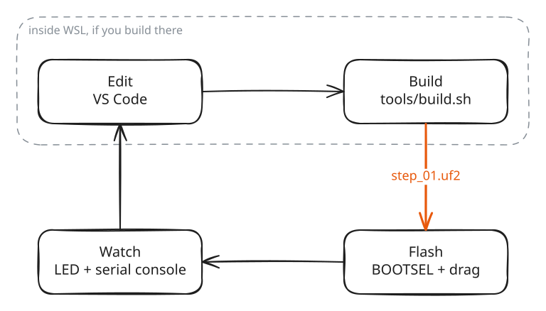
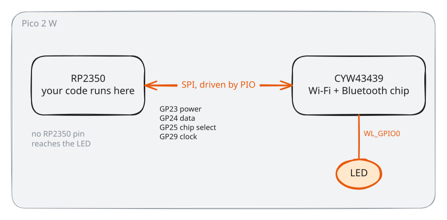

# Part 1 · Blink and serial

**Goal:** understand the basic mechanics of working with a Pico 2 W. We build
a program, flash it and run it, using a blinking LED and a counter printed on
our computer. Along the way, we see what the main loop is and how it drives
the hardware, because every later part runs inside the same kind of loop.

!!! abstract "In this part"
    - Install the Pico SDK toolchain
    - Build a `.uf2` and flash it to the board
    - Read the board's USB console
    - Write a main loop that never blocks

## What you need

- A Raspberry Pi Pico 2 W. The Pico 2 WH has the headers already soldered.
- A micro-USB cable **that carries data**. Many cables only charge.
- A computer running Windows, Linux or macOS.

## The big picture

Every part of this series uses the same four actions, in order to program the
board. At first, you are asked to **edit** your code in C, in VS Code, and to
compile and **build** it. Once that is done, you will be able to **flash** it
into the board, and to **observe** what happens: in this case, the LED that
blinks, and the output text the board prints over USB.

{ .diagram loading=lazy }

*The `.uf2` file is the only thing that travels from your computer to the board.*

## 1. Install the toolchain

Install [VS Code](https://code.visualstudio.com/) and the official
**Raspberry Pi Pico** extension. The extension manages everything else in
`~/.pico-sdk`: the Arm cross-compiler, CMake, Ninja, `picotool` and the SDK
itself. You don't need `apt`, `brew` or `sudo`.

**You should see:** a Raspberry Pi Pico icon in VS Code's left sidebar.

<a id="building-inside-wsl2"></a>

??? info "Building inside WSL2?"
    If you are building like me, in VS Code on Windows through the **WSL**
    extension, you might have to pay attention to three things:

    - **Extensions are split.** Anything that touches code (C/C++, CMake
      Tools, Raspberry Pi Pico) must be installed *into WSL*. The Extensions
      panel shows a separate "Install in WSL" button for them.
    - **Keep the project on the Linux filesystem**, under `~/`, and not under
      `/mnt/c/`. Builds across that boundary are much slower.
    - **The serial console lives on the Windows side.** WSL2 can't see USB
      devices without extra tools. Make the Serial Monitor extension run
      locally in your `settings.json`:

        ```json
        "remote.extensionKind": { "ms-vscode.vscode-serial-monitor": ["ui"] }
        ```

    The Pico extension also works natively on Windows. WSL is my choice, not a
    requirement.

## 2. Get the code

```bash
git clone https://github.com/btbbass/picotalkie.git
cd picotalkie
code .
```

Every part is a folder, and one CMake build compiles them all:

```text
picotalkie/
├── CMakeLists.txt     board choice, SDK set-up, list of steps
├── step_01/           this part
├── step_02/           the next one
└── build/             created by the first build
```

The first time you open the folder, the Pico extension fetches the SDK and
toolchain versions that `CMakeLists.txt` asks for. That can take a few
minutes.

**You should see:** `ls ~/.pico-sdk` lists `cmake`, `ninja`, `picotool`,
`sdk` and `toolchain`.

## 3. The obvious blink

Most blink examples look like the code below, which I left out of the
repository on purpose, because it is the version we want to avoid.

```c title="The textbook blink (not in the repository)"
while (true) {
    cyw43_arch_gpio_put(LED_PIN, true);
    sleep_ms(800);                          // the CPU waits here...
    cyw43_arch_gpio_put(LED_PIN, false);
    sleep_ms(200);                          // ...and here
    printf("blink %" PRIu32 "\n", count++);
}
```

This works, but during `sleep_ms(800)` the CPU does nothing else. On a PC,
the operating system would give the CPU to another program while yours
sleeps. Here there's no operating system and no other program, so nothing
runs until the sleep ends.

For a blink this doesn't matter. In part 4 the same loop has to collect audio
every 20 ms, and an 800 ms pause would lose 40 audio blocks.

## 4. A loop that never waits

Instead of waiting, the loop checks whether enough time has passed. The
repository's version:

```c title="step_01/main.c (excerpt)"
#define LED_PIN CYW43_WL_GPIO_LED_PIN               // (1)!
// ...
    while (true) {
        uint32_t now = to_ms_since_boot(get_absolute_time());

        if (!led_on && (now - last_update) >= OFF_MS) {   // (2)!
            cyw43_arch_gpio_put(LED_PIN, true);
            led_on = true;
            last_update = now;
        }

        if (led_on && (now - last_update) >= ON_MS) {
            cyw43_arch_gpio_put(LED_PIN, false);
            led_on = false;
            last_update = now;

            printf("blink %" PRIu32 "\n", count++);
        }
    }                                                   // (3)!
```

1. Not an RP2350 pin. The LED hangs off the wireless chip, so it's switched
   with `cyw43_arch_gpio_put()`, not `gpio_put()`.
2. Subtract, don't add. The millisecond counter wraps after about 49.7 days,
   and unsigned subtraction gives the right gap across the wrap.
3. Nothing here waits.

Before the loop, `cyw43_arch_init()` boots the wireless chip. Then, on every
pass:

1. Read the time.
2. If the LED has been off for 200 ms, switch it on.
3. If it has been on for 800 ms, switch it off and print the counter.
4. Go round again.

A pass takes microseconds, so the loop asks thousands of times a second.
Later parts add more questions to it: is there audio to move, was the button
pressed?

<a id="why-while-true"></a>

??? info "Why `while (true)`? And what if it's missing?"
    On a PC, `main()` returns to the operating system, which cleans up and
    goes back to the shell. Here there's nothing to return to. Your program
    is the only thing on the chip, and it has to keep running while the board
    has power. That's why `main()` ends in an endless loop. This shape, one loop that
    checks everything in turn, is called a **superloop**. A later article
    looks at this execution model properly.

    If `main()` returns anyway, the SDK's start-up code calls `exit()`
    (`pico_crt0/crt0.S`: `bl main`, then `bl exit`). Its `_exit()`
    (`pico_clib_interface/newlib_interface.c`) then runs a breakpoint
    instruction forever.

    With a debugger attached, the core stops there and the debugger shows you
    where. Without one, the breakpoint turns into a fault, and the default
    fault handler is another breakpoint, so the core locks up and runs
    nothing more. The LED keeps its last state, and the serial port should
    stop answering. Exercise 4 below lets you see it.

    One build option changes this: with `PICO_ENTER_USB_BOOT_ON_EXIT`
    defined, returning from `main()` reboots the board into BOOTSEL mode,
    ready for the next `.uf2`.

{ .diagram loading=lazy }

*Every change to the LED is a command sent to the wireless chip over SPI.*

## 5. Build

```bash
tools/build.sh step_01
```

`cmake` and the compiler live in `~/.pico-sdk`, not on your `PATH`, so a bare
`cmake` can't find them. The script adds them, then builds. The extension's
**Compile Project** button does the same.

**You should see** the build end with:

```text
[5/5] Linking CXX executable step_01/step_01.elf
```

and a new file, `build/step_01/step_01.uf2`.

<a id="why-is-hello-world-270-kb"></a>

??? info "Why is hello world 270 KB?"
    Booting the wireless chip means uploading its own firmware into it, and
    that firmware is built into your program. Measured on this build with
    `arm-none-eabi-nm -S`:

    | | bytes |
    |---|---:|
    | whole program, `step_01.bin` | 276,688 |
    | CYW43 firmware, `w43439A0_…_combined` | 225,240 |

    Four fifths of "hello world" is Wi-Fi firmware.

    The `.uf2` is about 554 KB, twice the `.bin`. Each 512-byte UF2 block
    carries only 256 bytes of program, plus its address. That's what lets the
    board accept a file dragged onto it like a USB stick.

## 6. Flash

1. Hold the **BOOTSEL** button on the board.
2. Plug in the USB cable, still holding it.
3. Let go. A drive called **RP2350** appears.
4. Drag `step_01.uf2` onto it.

From a WSL terminal, `explorer.exe build/step_01` opens the folder in Windows,
ready to drag.

**You should see** the drive disappear: the board restarts after writing the
file, and the LED starts blinking, on for 800 ms and off for 200 ms.

## 7. Watch the console

The board shows up as a USB serial port: a COM port on Windows,
`/dev/ttyACM0` on Linux, `/dev/tty.usbmodem…` on macOS. In VS Code, open it
with the **Serial Monitor** extension.

Three surprises:

- **The port vanishes when you flash.** After the reboot it can come back
  with a different number.
- **The first lines are lost.** USB only delivers text once your computer
  opens the port.
- **The baud rate doesn't matter.** It's USB pretending to be a serial port.
  Any setting works.

**You should see:**

```text
blink 0
blink 1
blink 2
```

## When it doesn't work

| Symptom | Likely cause | Check |
|---|---|---|
| No RP2350 drive appears | Charge-only cable, or BOOTSEL released too early | Try another cable. Hold BOOTSEL until the drive appears |
| Build errors mentioning `cyw43` | Wrong board | `CMakeLists.txt` must say `pico2_w` |
| `cmake: command not found` | `cmake` run directly | Use `tools/build.sh` |
| LED blinks, console empty | Old port, or wrong port | Close the port and reopen it after the reboot |
| Flashes, but the LED never lights | `cyw43_arch_init()` failed | Unplug, plug back in, flash again |

## Try this

1. Swap `ON_MS` and `OFF_MS`. Predict what the LED does, then flash it.
2. Print the uptime next to the counter: `now / 1000` is seconds.
3. Search `build/step_01/step_01.dis` for `count`. You won't find it: it lives
   in a CPU register for its whole life.
4. Delete the `while (true) {` line and its closing brace, so the code runs
   once. Flash it, and watch the LED and the console.

## Recap

- We can now build a program, flash it, and read what it prints on the
  console.
- The onboard LED is controlled through the wireless chip, and that chip's
  firmware is most of our binary.
- Our main loop does not wait, so later parts can keep up with the audio.

## With a breadboard: an external LED

The onboard LED goes through the wireless chip because, on the Pico 2 W, the
pin the plain Pico 2 uses for its LED (GP25) is taken by that chip. With a
breadboard, an LED and a 220–330 Ω resistor, you can wire an LED to any free
GPIO and drive it directly with `gpio_put()`. You won't need
`cyw43_arch_init()`, and the Wi-Fi firmware stays out of the binary. Later
parts use GP15 for a status LED this way.

## Full listing

```c title="step_01/main.c"
--8<-- "step_01/main.c"
```

---

**Next:** [Part 2 · A debounced button →](02-debounced-button.md). We add the
push-to-talk button, and handle the fact that one press produces several
electrical transitions.
