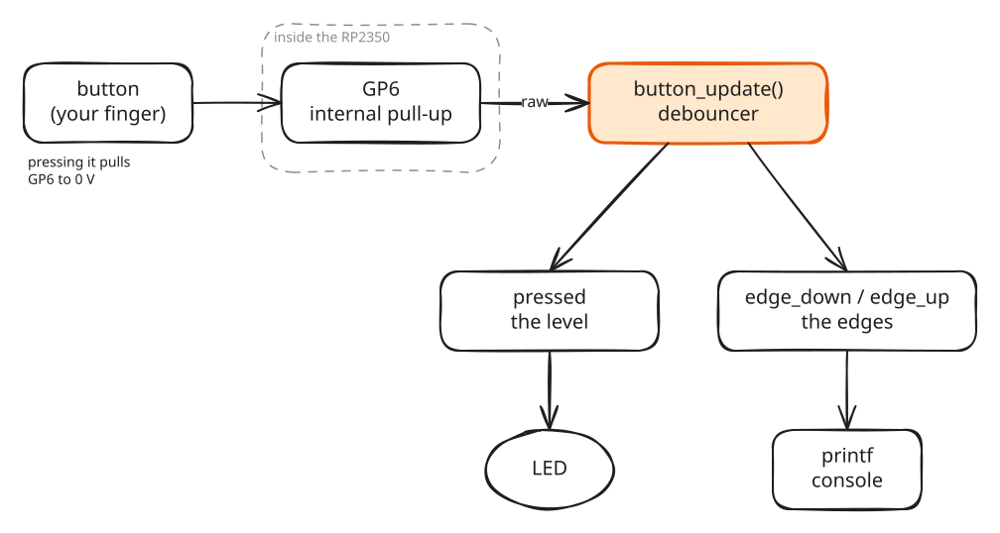
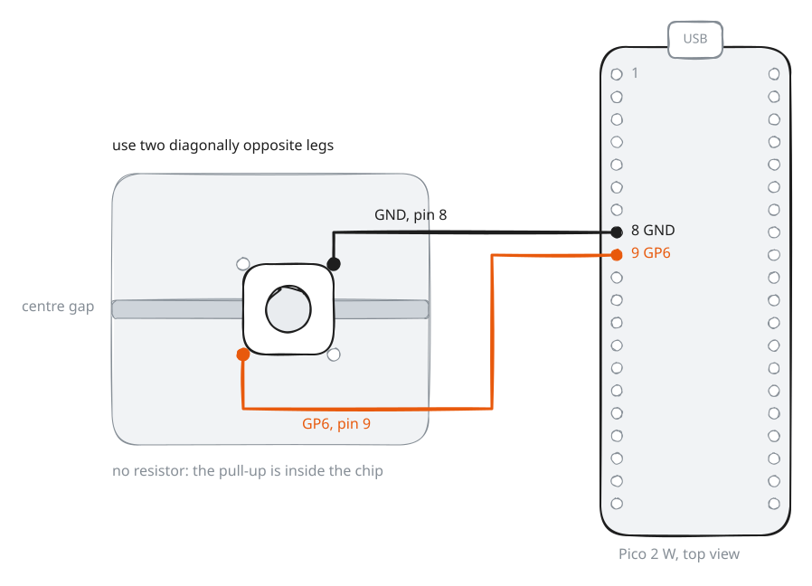
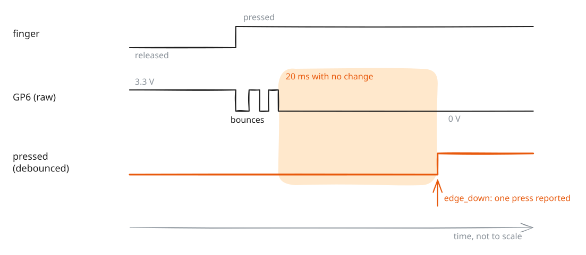

# Part 2 · A debounced button

**Goal:** wire a push-to-talk button and read it reliably. You'll see why a
mechanical contact produces several transitions for one press, and how a
20 ms debounce turns them into exactly one press and one release.

!!! abstract "In this part"
    - Wire a button with no resistor
    - See the "bouncing effect"
    - Apply debouncing techniques
    - Experiment and measure bouncing

## What you need

| Part | Qty | Notes |
|---|---:|---|
| Pico 2 W, from [part 1](01-blink-and-serial.md) | 1 | Any Pico works for the button. The LED line in the code is written for the W boards |
| Breadboard | 1 | |
| Push button | 1 | A standard 6 mm tactile switch |
| Jumper wires | 2 | |
| Multimeter | 1 | Optional, for the checks |

## The big picture

A button is a simple component, only slightly more complex than a piece of
wire 😉. When you press it, it behaves like a wire and physically connects its
two pins. In our case it connects GP6 to ground, so the program can detect
whether it's pressed.

There is one problem, though. Because the program reads the pin continuously,
it also sees the metal contacts bouncing like a spring when the button is
pressed or released, and that produces spurious readings. That's why we
introduce debouncing, a technique that filters those readings and tells when
the button really changes state.

To do that, we use a function, `button_update()`, that sits between the pin
and the rest of our program. It reads the raw values and turns them into two
things we can use: a *level* (is the button held down right now?) and *edges*
(did it change on this pass of the loop?).

{ .diagram loading=lazy }

*The LED follows the level, and the console prints on edges.*

## 1. Wire the button

| Button leg | Pico 2 W pin | Name |
|---|---|---|
| one leg | **pin 9** | GP6 |
| the diagonally opposite leg | **pin 8** | GND |

First, we place the switch across the centre gap of the breadboard, and we
use two legs that are diagonally opposite (whichever way the switch is turned,
those two are always on opposite sides of it).

We don't need a resistor, or a wire to 3.3 V: the chip has an internal
pull-up that holds GP6 at 3.3 V until the button connects it to ground. So
when the button is pressed, GP6 reads 0. This is called **active low**. In
`button.c` we invert the reading, so `!gpio_get(pin)` is true while the button
is pressed.

!!! warning "GP6 is not pin 6"
    Be careful here: `GP6` is the number we use in the code, but on the board
    it is the physical **pin 9** (counting from the USB connector, check the
    pinout below if you are not sure).

    { loading=lazy }

    *GP6 is pin 9, and pin 8 is GND. Pinout © Raspberry
    Pi Ltd, [CC BY-SA 4.0](https://creativecommons.org/licenses/by-sa/4.0/),
    from the [Raspberry Pi documentation](https://www.raspberrypi.com/documentation/microcontrollers/pico-series.html).*

Build `step_02` and flash it as in part 1 ([build](01-blink-and-serial.md#5-build),
[flash](01-blink-and-serial.md#6-flash)).

**You should see:** the LED on while you hold the button. With a multimeter
between GP6 and GND: 3.3 V released, 0 V pressed.

{ .diagram loading=lazy }

*GP6 (pin 9) to one leg, GND (pin 8) to the diagonal leg. No resistor.*

<a id="why-no-resistor"></a>

??? info "Why no resistor?"
    An input with nothing connected floats. It picks up noise and reads 0 or 1
    at random, so something has to hold it at a known level. Every RP2350 GPIO
    has a weak resistor to 3.3 V (pull-up) and one to ground (pull-down) that
    software can switch on. `gpio_pull_up()` turns on the first.

    Wiring the button to ground with the pull-up on has two advantages. A wire
    that falls out reads as released, which is the safe failure for a
    transmit button. It also avoids RP2350 erratum E9. On early revisions of
    the chip, an input that relies on the internal pull-down can leak current.
    It can then sit around 2 V, between a clean 0 and a clean 1. Pull-ups are
    not affected, and the A4 revision of the chip fixes it.

## 2. See the bounce

Before fixing anything, look at what the pin really does. In
`step_02/button.c`, set the debounce time to zero:

```c title="step_02/button.c"
#define DEBOUNCE_MS 0u
```

Build and flash again, [open the console](01-blink-and-serial.md#7-watch-the-console),
and press the button once.

**You should see** several lines for one press. For example (your numbers
will differ):

```text
PTT down @   4210 ms  (0 bounces rejected)
PTT up   @   4210 ms  (0 bounces rejected)
PTT down @   4211 ms  (0 bounces rejected)
```

When two metal contacts close, they hit, spring apart and hit again for a few
milliseconds. The program reads the pin much faster than that, so it reports
every hit as a press or a release.

{ .diagram loading=lazy }

*The press is reported 20 ms after the last bounce.*

## 3. Debounce with the 20 ms rule

Set `DEBOUNCE_MS` back to `20u`. The rule is that a new level only counts once
it has stayed the same for 20 ms. Contact bounce lasts a few milliseconds, and
a human press lasts much longer than 20 ms.

```c title="step_02/button.c (excerpt)"
void button_update(button_t *b, uint32_t now_ms) {
    b->edge_down = false;
    b->edge_up   = false;

    bool raw = !gpio_get(b->pin);   // invert: active low

    if (raw != b->raw) {
        // A change arriving less than DEBOUNCE_MS after the previous one is
        // the contact chattering, not a finger: count it. (1)
        if ((now_ms - b->last_change_ms) < DEBOUNCE_MS) b->bounces++;

        b->raw            = raw;
        b->last_change_ms = now_ms;
        return;                     // it moved: restart the clock (2)
    }

    if (raw != b->pressed && (now_ms - b->last_change_ms) >= DEBOUNCE_MS) {
        b->pressed = raw;           // stable long enough: commit (3)
        if (raw) b->edge_down = true;
        else     b->edge_up   = true;
    }
}
```

1. Bounces are counted only to show you how many there were. The debounce
   works without the counter.
2. Any change restarts the 20 ms clock. While the contact bounces, it never
   stays still for 20 ms, so nothing is reported.
3. Stable for 20 ms and different from the current level: commit the new
   level, and raise one edge for exactly one call.

One press, step by step:

| Time | Pin | What happens |
|---:|:---:|---|
| 0 ms | pressed | changed: the clock restarts |
| 1 ms | released | changed within 20 ms: bounce 1, the clock restarts |
| 2 ms | pressed | changed within 20 ms: bounce 2, the clock restarts |
| 3–21 ms | pressed | unchanged, waiting |
| 22 ms | pressed | stable for 20 ms: `pressed = true`, `edge_down` for one call |

**You should see** one line per press and one per release:

```text
PTT down @   5123 ms  (2 bounces rejected)
PTT up   @   5480 ms  (0 bounces rejected)
```

## 4. Levels and edges

```c title="step_02/button.h (excerpt)"
typedef struct {
    uint32_t pin;
    bool     pressed;        // debounced level
    bool     edge_down;      // true for one update, on press
    bool     edge_up;        // true for one update, on release
    bool     raw;            // internal
    uint32_t last_change_ms; // internal
    uint32_t bounces;        // number of bounces
} button_t;
```

`pressed` is a **level**: true for as long as the button is held.
`edge_down` and `edge_up` are **edges**: true for exactly one call, when the
level changes. The main loop uses both:

```c title="step_02/main.c (excerpt)"
    while (true) {
        uint32_t now = to_ms_since_boot(get_absolute_time());

        button_update(&ptt, now);

        if (ptt.edge_down || ptt.edge_up) {
            printf("PTT %-4s @ %6" PRIu32 " ms  (%" PRIu32 " bounces rejected)\n",
                   ptt.edge_down ? "down" : "up", now, ptt.bounces);
            ptt.bounces = 0;        // count per transition, not forever
        }

        cyw43_arch_gpio_put(LED_PIN, ptt.pressed);
    }
```

The LED follows the level, through the wireless chip as in
[part 1](01-blink-and-serial.md#4-a-loop-that-never-waits), while the `printf`
runs only on the edges. Later on, the transmitter will need the same split,
because it keeps sending while the button is held (the level), and it starts
and stops the stream when the button changes (the edges).

<a id="why-poll-instead-of-using-an-interrupt"></a>

??? info "Why poll instead of using an interrupt?"
    An interrupt would run code the moment GP6 changes. With a bouncing
    contact that means one interrupt per bounce, and the same 20 ms logic
    would still be needed, split between the interrupt handler and the loop.

    The loop is already running, as in
    [part 1](01-blink-and-serial.md#3-the-obvious-blink), and one call to
    `button_update()` takes well under a microsecond. In later parts the loop
    runs once per 20 ms audio block, so the worst-case delay is about 40 ms:
    one block plus the debounce time. That's too short to notice on a
    push-to-talk button.

## When it doesn't work

| Symptom | Likely cause | Check |
|---|---|---|
| Always reads pressed | Two legs that are joined inside the switch | GP6 reads 0 V even when released. Use diagonal legs |
| Never reads pressed | Wire on physical pin 6 instead of GP6 (pin 9) | GP6 stays at 3.3 V when pressed |
| GP6 isn't at 3.3 V when released | `step_02` isn't running, so the pull-up is off | Flash `step_02` again |
| Nothing printed | The console port was opened before the reboot | [Reopen the port](01-blink-and-serial.md#7-watch-the-console) |
| Lines appear without touching the button | A loose jumper | Push the jumpers in firmly |

## Try this

1. Set `DEBOUNCE_MS` to `200` and press quickly several times. Which presses
   go missing, and why?
2. Wire a second button to GP7 (pin 10). Declare a second `button_t`, call
   `button_init()` and `button_update()` for it, and print its edges.
   `button.c` doesn't change.

## Recap

- An active-low button needs two wires. The internal pull-up does the rest.
- The bouncing effect produces several transitions for each press. A level that stays the same for
  20 ms is the real one.
- A level says what the button is doing. An edge says when it changed.

## Full listings

```c title="step_02/button.c"
--8<-- "step_02/button.c"
```

```c title="step_02/main.c"
--8<-- "step_02/main.c"
```

---

**Next:** part 3 reads an I²S microphone through PIO. It's coming soon.
